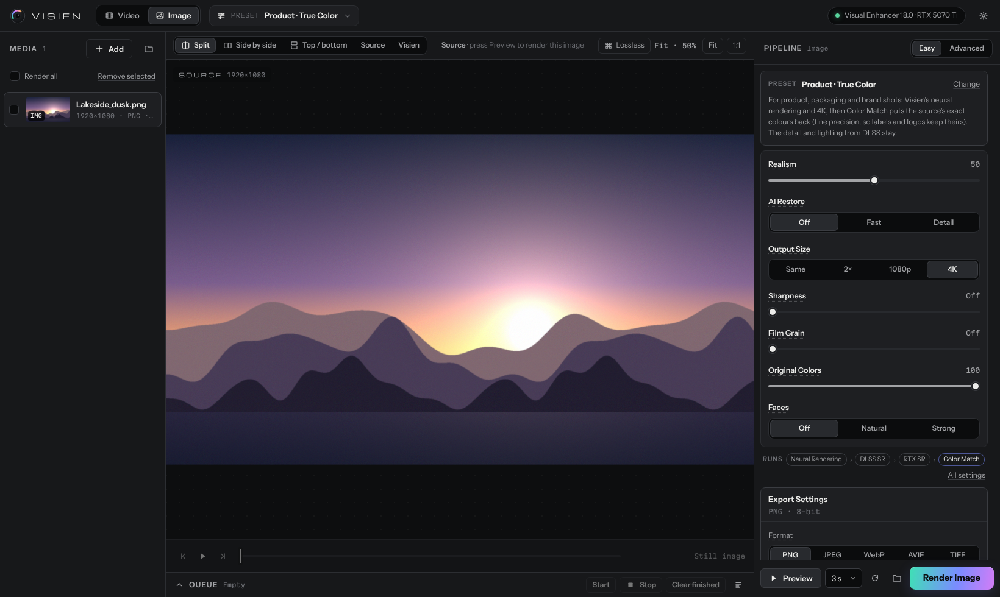

# Visien 1.3

**English** · [Türkçe](README.tr.md)

**Project page:** https://engnalrr.github.io/visien/ · **Download:** [Releases](https://github.com/engnalrr/visien/releases/latest) · [Changelog](CHANGELOG.md)

**An enhancement studio for AI-generated video and images.** Visien brings DLSS 5 Neural Rendering (through
Merserk's **Visual Enhancer**) and its own AI models (SeedVR2, RIFE, face restoration, Color Match) together in a
Topaz-style desktop app. Try settings on a few seconds of your clip, compare them with the source side by side,
then queue the settings you like and render every file.

- A desktop app in its own window (no browser needed)
- **Easy mode:** eight short controls on top of a preset (Realism, AI Restore, Output Size, Sharpness, Film Grain,
  Smooth Motion, Original Colors, Faces). **Advanced:** every stage and every setting.
- **Hover help** on every control, explaining what it does
- **AI models** (run on the GPU in Visien's own AI runtime):
  - **SeedVR2** (ByteDance): brings real texture back to soft, compressed AI video and upscales it to 1080p
  - **RIFE 4.26** (Practical-RIFE): frame interpolation (24 → 48/60 fps) that respects scene cuts
  - **Face restoration:** GFPGAN 1.4 (commercial use allowed) or CodeFormer (non-commercial use only)
  - **Color Match:** restores the source's colours after rendering (products, brands, skin tones) without touching
    the detail and light DLSS adds
- **Clean Shot Starts:** the first frames of each shot in a multi-shot video no longer look unprocessed
- **Comparison copy:** a top/bottom (or side-by-side) video next to the result, labelled RAW / NEURAL ENHANCED
- Every Visual Enhancer stage: DLSS Neural Rendering, DLSS Super Resolution, Ray Reconstruction,
  RTX Super Resolution, RTX Video HDR, DLSS / FSR / NVIDIA Frame Generation, ReShade, Coloring, Sharpening,
  Grain, NVIDIA Video Super Resolution, Lightweight Upscale
- AI stages and Visual Enhancer stages run in one ordered pipeline; reorder them with the arrows
- Previews: 1–10 seconds from the playhead, or a single image; Split, Side by side, Top / bottom, Source and Visien
  views; zoom, pan, frame stepping, lossless (PNG) frame comparison
- Queue: multiple files, reordering, stop, retry, time remaining, logs
- Ready-made presets, especially for making AI output look more real (see below)

---

## Requirements

| Requirement | Notes |
| --- | --- |
| **Windows 11, 64-bit** | Visual Enhancer needs Windows 11. The Visien interface also opens on Windows 10. |
| **NVIDIA GeForce RTX GPU** | RTX for Neural Rendering; RTX 40 or 50 series for Frame Generation. At least 12 GB of video memory for the AI models, 16 GB recommended (tested on an RTX 5070 Ti 16 GB). 24 GB recommended for SeedVR2 7B. |
| *(or)* **AMD Radeon RX 7000 / 9000** | Only the **AI stages** run (SeedVR2, RIFE, face restoration, Color Match); Visual Enhancer's DLSS / RTX stages need NVIDIA. Visien detects the AMD card and sets up the AI runtime with AMD's PyTorch (ROCm) (tested on an RX 9070 XT 16 GB). |
| **A current NVIDIA driver** | From the NVIDIA App or nvidia.com/drivers (a driver with CUDA 12.8 support). |
| **Visual Enhancer v18 or newer** (tested with 19.5) | Downloaded separately (see below). Visien does not include it. |
| **Microsoft Edge WebView2 Runtime** | Built into Windows 11. If it is missing, setup tells you: https://go.microsoft.com/fwlink/p/?LinkId=2124703 |
| **Memory (RAM)** | 16 GB; 32 GB or more when SeedVR2 uses Block Swap. |
| **Free disk space** | ~10 GB once everything is installed. The preview cache is capped at 10 GB by default; leave extra room for outputs and SeedVR2's intermediate files. |
| **Internet** | Setup downloads Python, the packages and ffmpeg (~200 MB); the recommended AI models are ~9 GB. A full offline package needs none. |
| *(for DLSS Frame Generation)* | Windows Settings › System › Display › Graphics › **Hardware-accelerated GPU scheduling** must be on. |

Visien does not install Python system-wide and does not change system settings; everything is installed inside its
own folder.

## Installation

1. Download **`Visien-1.3.0.zip`** from [Releases](https://github.com/engnalrr/visien/releases/latest) and extract
   it to a permanent folder (for example `D:\Apps\Visien`). A path without non-English characters is recommended.
2. Double-click **`install.bat`**. It downloads Python, the packages and ffmpeg, checks the computer (GPU, AI
   runtime, models) and creates the shortcuts. The result is written to `check.log`.
3. Start **Visien** from the desktop or Start menu shortcut (or `Visien.bat`).
4. Install the AI models from **Settings › AI models › Install recommended** (SeedVR2 3B FP8 + VAE, RIFE 4.26,
   GFPGAN 1.4, YuNet; ~9 GB).

**Updating:** extract the new zip over your Visien folder; settings, presets and models are kept.
**Settings › Updates** checks GitHub for a newer version.

**Full offline package:** on a PC where everything is installed, **Settings › Share Visien › Create full package**
builds a ~9 GB zip with Python, the packages, ffmpeg, the AI runtime and the recommended models. On another PC,
`install.bat` then only checks the computer and creates the shortcuts; no internet is needed.

Neither package includes **Visual Enhancer** (its licence does not allow redistribution). **CodeFormer** is not
included either: its licence only allows non-commercial use, so you add it yourself from Settings › AI models after
accepting the licence.

If you move the folder later, run `install.bat` again (the shortcuts are updated). If Windows shows an "unknown
publisher" warning, it is because the files are not signed. To uninstall, delete the folder and the two shortcuts.

## Using an AMD Radeon GPU

On Radeon RX 7000 / 9000 series and Ryzen AI Max, Visien runs the AI stages on the GPU with AMD's PyTorch for
Windows (ROCm 7.14):

- **Settings › AI models › AI runtime › Install** installs the AMD build (~1.5 GB). If a full package copied from an
  NVIDIA PC was extracted, the same row shows **Update: switches PyTorch to the AMD Radeon (ROCm) build**; the
  models are not downloaded again, only PyTorch changes.
- Presets to use on AMD: **Realism · SeedVR2 Restore**, **Realism · Faces**, **Realism · Faces · CodeFormer**,
  **Smooth 60 · RIFE**. The Visual Enhancer stages in these presets (Neural Rendering, DLSS SR, RTX Super Resolution,
  Grain) are skipped automatically on AMD and the AI stages run; Visien shows this as a warning in the preview.
  Presets made only of Visual Enhancer stages (Visien, Natural Skin, Clean 4K …) do not run on AMD.
- Output video is encoded with AMD's hardware encoder (AMF).
- Measured on an RX 9070 XT: RIFE takes a 12-second clip to 60 fps in ~25 seconds, SeedVR2 ~4 seconds per frame at
  720p, GFPGAN ~25 ms per face. The first run of each AI model takes 15–40 seconds longer while AMD compiles its
  kernels.

## Connecting Visual Enhancer

Visien runs the Visual Enhancer stages through its official command-line tool, `VE_CLI.exe`.

1. Press **Download page** in Settings, or go to https://github.com/Merserk/dlss5-visual-enhancer/releases/latest.
2. Download the large `.zip` package under **Assets** (the "Source code" archives contain no executables).
3. Extract the whole zip to **Downloads**, the Desktop or Documents, or to Visien's `engine` folder.
4. Press **Find automatically**. The top bar shows `Visual Enhancer 18.0 · RTX …`. If you extracted it somewhere
   else, use **Choose folder…** to pick the folder that contains `VE_CLI.exe`.

Settings that only use AI stages (SeedVR2, RIFE, face restoration, Color Match) also work without Visual Enhancer;
Visien writes the output itself.

## Usage

1. Add videos and images with **Add**, or drag and drop them onto the window. Files stay where they are; they are not
   copied.
2. Pick a file in the list on the left. Video and image pipelines are set separately; both are saved in the same
   preset.
3. Choose **Easy** or **Advanced** at the top of the right panel:
   - **Easy:** the preset's description at the top and eight controls below it. Changing a control also sets the
     stages underneath; the **Runs** line shows which steps run, in which order. You can switch to Advanced without
     losing anything.
   - **Advanced:** turn stages on or off, reorder them with the arrows and edit their settings. Values that differ
     from the default show in green; ↺ resets them. Stages with an **AI** badge are Visien's own models.
4. Hover over any stage, setting or button for a short explanation.
5. Click a point on the timeline and press **Preview** (1/3/5/10 seconds). With SeedVR2 on, try 1–2 seconds first.
6. When you like the result, select the files and press **Render**. The queue is in the bottom panel; **Stop** stops
   the current job.

The line under the **Export Settings** card shows the output size and frame rate
(`854×480 · 24 fps → 3840×2160 · 24 fps`). If settings do not fit together, the Render button is disabled and the
reason is shown under the stages; when SeedVR2 will take long, the estimated time is shown too.

## Colours, multi-shot videos and comparisons

### Color Match (keep the original colours)

DLSS 5 Neural Rendering gets part of its realism by shifting colours; in a product video that can change the
product's colour. The **Color Match** stage (**Original Colors** in Easy mode) runs last and compares the result with
the source, but only corrects **colour over broad areas**:

- The result and the source are reduced to a blurred grid a few hundred pixels across and compared in CIELAB; the
  difference is scaled back up and added to the result. Fine texture, sharp edges and local contrast (everything
  DLSS adds) stay as they are.
- **Original Colors:** how much of the hue and saturation returns to the source (100 = exact; 60–80 keeps some of
  DLSS's colour).
- **Original Brightness:** how much of the overall brightness and contrast returns. At 0, DLSS's lighting stays.
- **Precision:** Broad (large areas), Balanced, Fine (small objects such as labels and logos too).
- Works after frame generation (RIFE, Frame Generation) and upscaling as well; the source is aligned in time.

### Clean Shot Starts

Neural Rendering, DLSS and SeedVR2 build each frame from the frames before it. At the start of the clip and after
every cut there is no previous frame, so the first 1–3 frames of a shot come out with different colours, as if they
had not been rendered. **Export › Clean Shot Starts** (on by default) finds the cuts, puts a short mirrored warm-up
made of the shot's next frames in front of every shot, runs every stage on that longer video and removes the warm-up
frames when it writes the final file. Duration, frame count and audio match the source. Skipped for HDR output.

### Comparison copy

When **Export › Comparison** is set to *Top / bottom* or *Side by side*, Visien also writes `<name>_compare.mp4`
(`.png` for images) next to the result: the source on top, the result below, with **RAW** and **NEURAL ENHANCED**
labels in the corners (both can be changed, for example to VISIEN or a client's name). The source is scaled to the
result's size and frame rate, and the audio comes from the source. **Fit 1080p** keeps each half at most 1920 pixels
(for sharing); **Full size** uses the result's resolution.

## AI models

| Model | What it does | Speed (RTX 5070 Ti, 16 GB) | Licence | Size |
| --- | --- | --- | --- | --- |
| **SeedVR2 3B FP8** | One-step diffusion restoration: real texture and sharpness in blurry, "painted", compressed AI video. Takes 480p–720p clips to 1080p. | 480p → 1080p: ~3.5 s per frame | Apache 2.0 | 3.4 GB + 0.5 GB VAE |
| SeedVR2 7B (optional) | More detail; about 3× slower, with Block Swap on a 16 GB card | — | Apache 2.0 | 8.3 GB |
| **RIFE 4.26** | In-between frames: 24 → 48/60 fps, never blends frames across a scene cut | 480p, 2 s → 60 fps: ~4 s | MIT | 25 MB |
| **GFPGAN 1.4** | Repairs broken, melting faces; 40–60 % strength for a natural result | ~0.1 s per frame | Apache 2.0 | 350 MB |
| CodeFormer (optional) | The most natural face restoration (adjustable Fidelity) | Close to GFPGAN | **NTU S-Lab 1.0: non-commercial use** | 380 MB |
| **Color Match** | Restores the source's colours; leaves detail and DLSS lighting alone | 4K: ~0.2 s per frame (including reading and writing) | Visien | no model |

- In the default order the AI stages run **before the Visual Enhancer stages**: SeedVR2 → Face Restore → Neural
  Rendering → DLSS → RIFE → RTX Super Resolution → colour/sharpening/grain → Color Match. Neural Rendering puts real
  skin texture back on restored faces; RIFE runs before upscaling, so it processes 4× fewer pixels.
- Frames travel between steps losslessly (FFV1 / PNG); audio is taken from the source.
- **SeedVR2 memory is managed automatically:** Visien limits PyTorch to the GPU's own memory. Instead of Windows
  spilling into system RAM and slowing the job down 50–100×, the job fails fast and Visien retries by itself with
  smaller VAE tiles and Block Swap.
- **Which sources suit SeedVR2:** 480p–1080p AI output. At 1440p and above it becomes very slow on a 16 GB card
  (~30 s per frame at 3380×1440); for those sources set Output Size to *Short side 1080* or use a preset without
  SeedVR2.
- **CodeFormer licence:** NTU S-Lab License 1.0 only allows non-commercial use. Use GFPGAN (the default) for client
  work and commercial projects. You are asked to accept the licence when installing CodeFormer.
- Models are downloaded from their official sources (Hugging Face `numz/SeedVR2_comfyUI`, GitHub releases) and
  verified against their published SHA-256 hashes.

## Presets

| Preset | What it does | Extra model |
| --- | --- | --- |
| **Visien** (recommended) | Neural Rendering (Style 0, Intensity 1.20, Local Structure 0.85, Automatic Mask), DLSS **DLAA** clean-up, RTX Super Resolution to a **short side of 2160** (1080p → 4K; a 4K clip stays 4K). H.265 MP4, Best. | — |
| **Visien 60** | Visien + 60 fps with NVIDIA Video Frame Generation and scene-cut detection. | — |
| **Visien Film** | Visien + light, moving film grain (Amount 12). | — |
| **Visien Native** | Neural Rendering + DLAA only, at the source size. The fastest test. | — |
| **Realism · Natural Skin** | For AI clips that look plastic or oversaturated: softer Neural Rendering, calmer colours and highlights (Saturation −6, Highlights −12), 4K, fine grain. | — |
| **Realism · SeedVR2 Restore** | The strongest clean-up: SeedVR2 3B restores texture and takes small clips to 1080p, then Neural Rendering, RTX 4K, fine grain. Slow: preview 1–2 seconds first. | SeedVR2 3B |
| **Realism · SeedVR2 Detail (7B)** | The same with the 7B "sharp" model tuned for detail. For hero shots and photos. | SeedVR2 7B |
| **Realism · Faces** | For shots where faces break: GFPGAN at 45 % strength, then Neural Rendering, 4K, grain. Commercial use allowed. | GFPGAN |
| **Realism · Faces · CodeFormer** | The same with CodeFormer (Fidelity 0.7). Non-commercial work only. | CodeFormer |
| **Product · True Color** | Product, packaging and brand shots: Visien's neural rendering and 4K, then Color Match puts the source's colours back exactly (Original Colors 100, Fine). | AI runtime |
| **Realism · Natural Colors** | The Visien look with most of the colour from the source (Color Match 70 %): skin, food, fashion. | AI runtime |
| **Smooth 60 · RIFE** | Visien + 60 fps with RIFE 4.26 (before upscaling, scene-cut aware). | RIFE |
| **Clean 4K** | Upscaling without changing the look: DLAA + RTX Super Resolution to 4K. No Neural Rendering, fast. | — |

Change the Easy mode controls on top of a preset and save your own with **Preset › Save as new preset…**. Presets use
Visual Enhancer's preset format (`schema_version 41`); a file saved with **Export current settings…** also opens in
Visual Enhancer (it ignores the AI stages' settings).

To copy your Visual Enhancer settings exactly: close Visual Enhancer (it saves its settings on exit) and press
**Preset › Copy settings from Visual Enhancer** in Visien.

### Viewer

| | |
| --- | --- |
| **Split** | Draggable divider; source on the left, Visien on the right |
| **Side by side** | Two panes that zoom and pan together |
| **Top / bottom** | Source on top, Visien below |
| **Source / Visien** | A single view |
| **Lossless** | Lossless PNG frames instead of playback copies (pixel-level comparison) |
| **Fit / 1:1** | Fit to the window / actual pixels |

**Shortcuts:** `Space` play/pause · `←/→` frame (10 frames with Shift) · `P` preview · `1` Split ·
`2` Side by side · `3` Source · `4` Visien · `5` Top / bottom · `F` fit · `Z` 1:1 · `L` Lossless · `Q` queue ·
`Ctrl+Enter` Render.

## Where files go

| What | Where |
| --- | --- |
| Rendered outputs | `Videos\Visien` (Settings › Output). `_Visien` is added to the name; existing files are never overwritten. |
| Previews | `data\previews` (lossless FFV1; limit and clean-up in Settings) |
| AI runtime and models | `ai\site-packages`, `models\` |
| AI intermediate files | `data\cache` (deleted when the job ends) |
| Settings, queue, media list, your presets | `data\` |
| Logs | `data\visien.log`, `data\logs\ai-*.log` for each AI step; the Visual Enhancer log path is shown on the job in the queue |

## Troubleshooting

- **"Visual Enhancer not connected"**: Settings › *Find automatically*.
- **The window does not open**: WebView2 may be missing or broken; Visien then opens in the browser.
  `Visien (browser).bat` always opens in the browser. Details in `data\visien.log`.
- **"CUDA 999 / engine poisoned"**: the GPU refused work at that moment (usually another program using the GPU at the
  same time). Visien retries by itself; if it keeps happening, close other GPU programs or restart Windows.
- **SeedVR2 is very slow**: if the clip is larger than 1080p, set Output Size to *Short side 1080*. Close Topaz,
  Resolve or games running at the same time. Details in `data\logs\ai-seedvr2-*.log` (time and memory per stage).
- **"Out of GPU memory"**: Visien first retries with smaller tiles by itself. If it still happens, raise Advanced ›
  SeedVR2 › Block Swap or keep Temporal Window at 5.
- **Flickering faces**: keep Face Restore Strength at 40–60 % and raise Temporal Smoothing.
- **An AI model could not be installed**: Settings › AI models shows the error; check the internet connection and
  press Install again. Downloads restart from the beginning.
- To run the setup check again, run `install.bat` (result in `check.log`).

## Sharing and licences

To share Visien, give the full package; the other person extracts it, runs `install.bat` and downloads Visual
Enhancer. Build the package whenever you like with **Settings › Share Visien › Create full package** (choose a
folder outside the Visien folder; ~9 GB, a few minutes), or **Create small package** for the small one. The same from
the command line: `runtime\python\python.exe dev\build_full_package.py full D:\Share\Visien-full.zip`.

Licences (not legal advice):

- **Visual Enhancer** (Merserk) is distributed under the *Merserk Source License 1.0*: its outputs may be used
  commercially; redistributing the app, bundling it into another product or rebranding it without written permission
  is not allowed. Visien does not include it; get written permission from Merserk before distributing Visien as a
  paid product.
- **AI models:** SeedVR2 (ByteDance Seed, Apache 2.0), Practical-RIFE (hzwer, MIT; architecture code from
  ComfyUI-Frame-Interpolation, MIT), GFPGAN (TencentARC, Apache 2.0) and YuNet (OpenCV, MIT) may be bundled.
  The code that runs SeedVR2 is in `vendor\seedvr2`, from numz/ComfyUI-SeedVR2_VideoUpscaler (Apache 2.0,
  unmodified). **CodeFormer** is limited to non-commercial use by the NTU S-Lab License 1.0; it is never bundled
  and users download it with their own consent. Do not make CodeFormer the default in a commercial product.
- **PyTorch** (BSD-3) and the NVIDIA CUDA libraries inside it come under NVIDIA's redistribution terms; OpenCV
  (Apache 2.0), spandrel (MIT) and the other packages' licences are in `ai\site-packages\*.dist-info`.
- **NVIDIA DLSS, RTX and NVENC** are trademarks of NVIDIA Corporation; AMD and Radeon are trademarks of Advanced Micro
  Devices. Visien is not affiliated with or endorsed by NVIDIA, AMD or Merserk.
- Python (PSF), FastAPI (MIT), Uvicorn (BSD-3), pywebview (BSD-3), pythonnet (MIT), ffmpeg (BtbN GPL build, GPLv3;
  licence and source information in `tools\ffmpeg`). Fonts: SIL Open Font License 1.1
  (`ui\assets\fonts\LICENSE-fonts.txt`).
- Visien's own source code is not published under an open-source licence yet.
